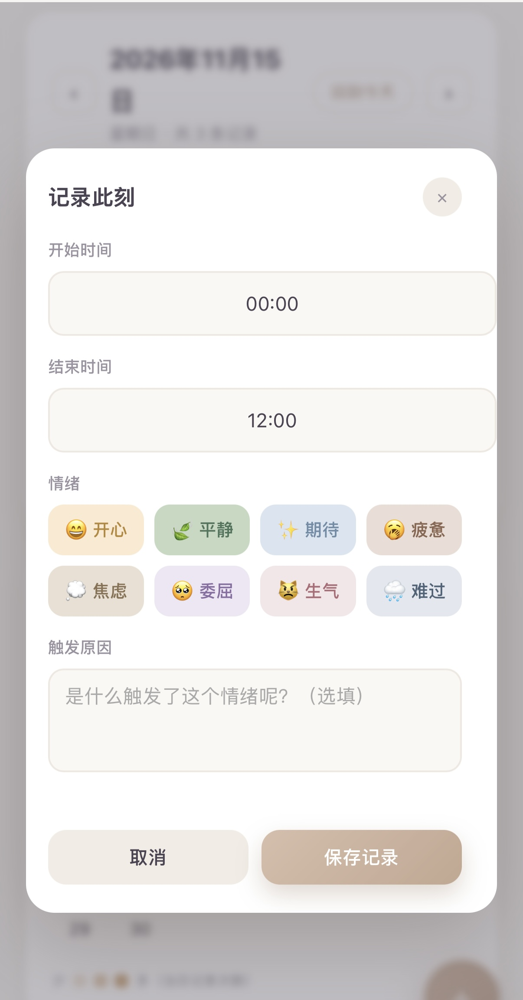
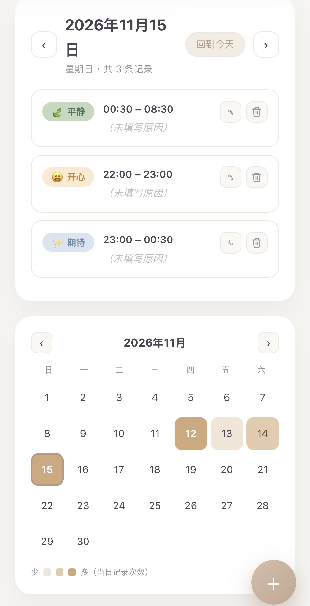
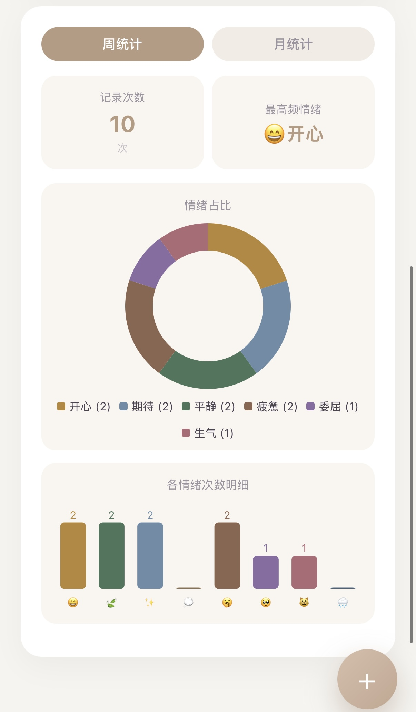

# 🌱 情绪树洞 (Emotion Diary)

一个极简、治愈、且绝对安全的情绪记录本。

> 💡 **无需登录，无需服务器，你的数据只保存在你自己的设备里。**

## 📸 界面预览

| 记录此刻 | 专属日历 |
| :---: | :---: |
|  |  |

### 📊 数据统计

## ✨ 核心功能
- **8 种情绪标签**：开心、平静、期待、疲惫、焦虑、委屈、生气、难过。
- **纯本地存储 (localStorage)**：断网也能用，绝对隐私。
- **原生 SVG 图表**：自动生成情绪占比（环形图）和次数明细（柱状图）。
- **iOS/Android 原生般体验**：支持添加到手机主屏幕（PWA）。

## 🚀 如何使用？
非常简单，不需要下载任何文件：
1. 在手机或电脑浏览器中打开：[点此访问情绪树洞](https://ptwdf.github.io/my-emotion-diary-/)
2. **iPhone 用户**：点击底部分享按钮 -> 选择“添加到主屏幕”。
3. **安卓用户**：点击右上角菜单 -> 选择“添加到主屏幕”。

## ⚠️ 数据安全提示
由于数据保存在浏览器本地，**清理浏览器缓存或更换设备会导致数据丢失**。请定期使用页面右上角的 `💾` 备份按钮，导出你的数据。

---
*Made with ❤️ and AI.*
